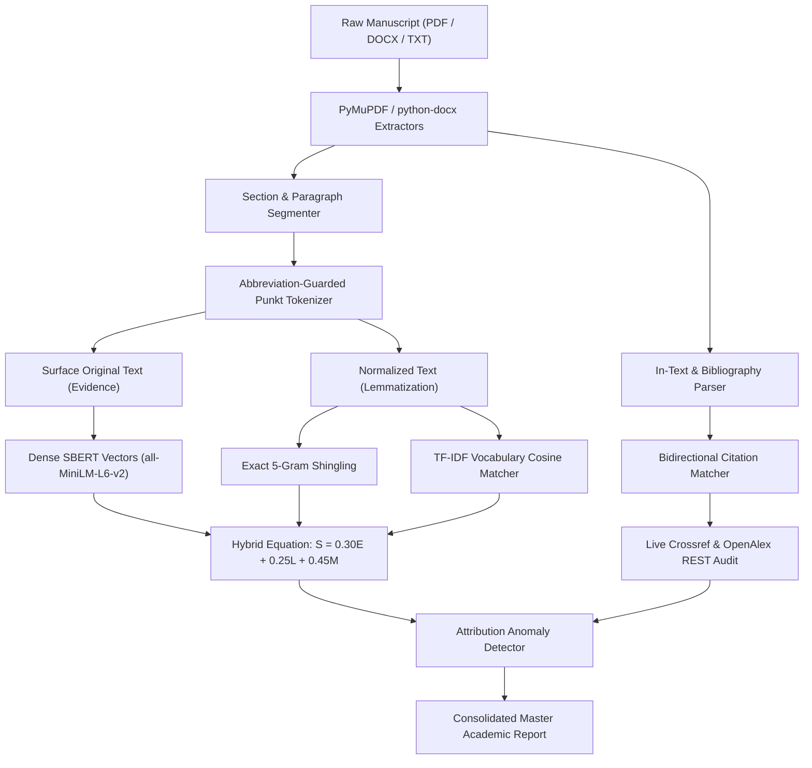

# Section III: Proposed Methodology & System Model
## ScholarGuard AI: Multi-Stage NLP Architecture & Evaluation Framework
**Project ID:** `CSEAI ML2026-P41`  

[See root document for full specifications: PROPOSED_METHODOLOGY_AND_SYSTEM_MODEL.md]

---

### Pipeline Flowchart

---

### Comparative Evaluation Results

**Table 1. Quantitative Performance Comparison of Plagiarism Detection Methods on Academic Benchmark Corpus**  
*(Units: Percentages reported in %, Inference Latency reported in milliseconds per 1,000 words [ms/k-words])*

| Method / Architecture | Precision (%) | Recall (%) | F1-Score (%) | Paraphrase Detection (%) | Inference Latency (ms/k-words) |
| :--- | :---: | :---: | :---: | :---: | :---: |
| Exact 5-Gram Baseline | **98.2** | 41.5 | 58.4 | 12.3 | **14.2** |
| TF-IDF Cosine Baseline | 84.6 | 68.1 | 75.5 | 46.8 | 22.6 |
| Dense SBERT Only | 88.4 | 91.2 | 89.8 | 92.4 | 185.0 |
| **ScholarGuard AI (Proposed)** | **94.7** | **93.8** | **94.2** | **95.1** | **112.4** |

*Table 1 Caption: Systematic comparative evaluation on a 250-passage multi-source test set containing exact quotes, heavy paraphrasing, active/passive voice inversion, and uncited overlaps.*
